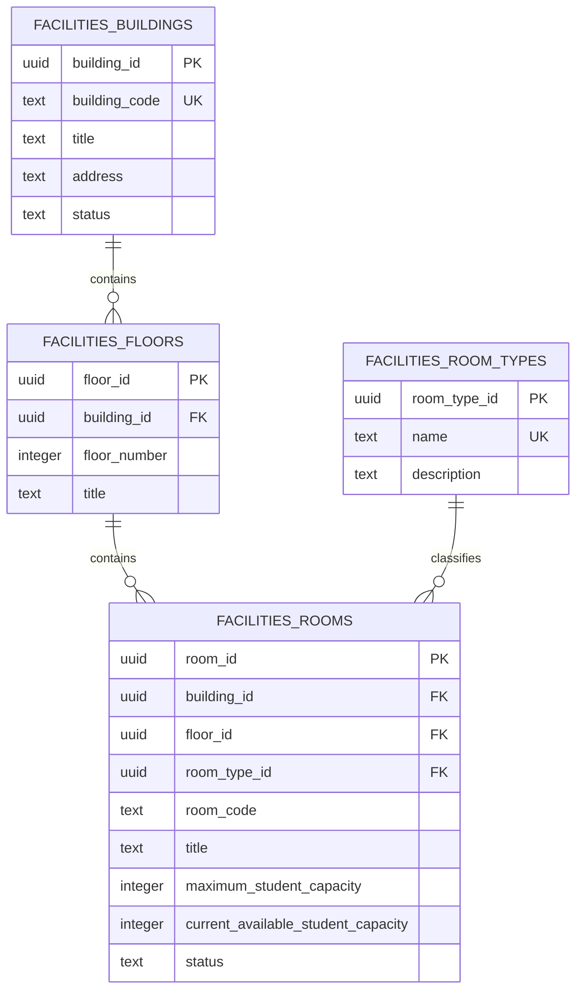

# Facilities data model

This document describes the Drizzle schema in `packages/db/src/schema/facilities/`. Each entity is defined in its own file and exported through the Facilities schema index.

## Entity relationships

## Entities

### Building

Defined in `buildings.ts` as `facilitiesBuildings` (`facilities_buildings`). A building has a generated UUID, a required unique building code, a required title, optional address, and a status that defaults to `active`.

### Floor

Defined in `floors.ts` as `facilitiesFloors` (`facilities_floors`). A floor belongs to one building and has a required floor number and optional title. Floor numbers are unique within a building. The composite unique key on `(floor_id, building_id)` supports ensuring each room's floor belongs to the same building recorded on the room.

### Room type

Defined in `room-types.ts` as `facilitiesRoomTypes` (`facilities_room_types`). A room type has a generated UUID, required unique name, and optional description. Example values include classroom, laboratory, office, and storage. The allowed values are data, rather than a database enum, so they can be maintained without changing the schema.

### Room

Defined in `rooms.ts` as `facilitiesRooms` (`facilities_rooms`). Each room belongs to a building and floor, and has one required room type. It also has a required room code and human-readable title, optional student capacity values, and a status that defaults to `active`.

Room codes are unique within a building; duplicate codes are allowed in different buildings. `maximum_student_capacity` and `current_available_student_capacity` are nullable for room types where student capacity does not apply. When supplied, capacities must be nonnegative, and current available capacity cannot exceed maximum capacity. Only the current available value is stored; capacity change history is not modeled.

## Shared columns and deletion behavior

All four tables include `created_at` and `updated_at` timestamps from the shared `timestamps()` helper. Primary keys are generated UUIDs.

Referenced buildings, floors, and room types use restrictive deletion behavior: records in use cannot be deleted until dependent records are handled. Room-to-floor consistency is enforced with a composite foreign key over `(floor_id, building_id)`.

## Inventory boundary

The Facilities schema currently defines the location hierarchy only. It does not duplicate equipment records or create an Inventory foreign key. Inventory remains responsible for equipment, its mandatory responsible party, and custody history. A later integration can reference a room from Inventory so Facilities can display items located in each room. Room location is independent of responsible party and can be absent for mobile equipment.

## Source files

- [`buildings.ts`](../../../packages/db/src/schema/facilities/buildings.ts)
- [`floors.ts`](../../../packages/db/src/schema/facilities/floors.ts)
- [`room-types.ts`](../../../packages/db/src/schema/facilities/room-types.ts)
- [`rooms.ts`](../../../packages/db/src/schema/facilities/rooms.ts)
