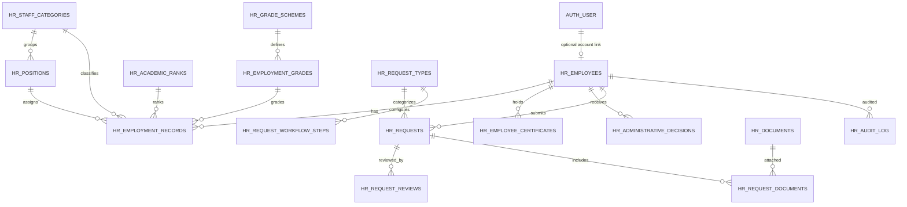

# HR Data Model

This document describes the initial HR database schema. It is implemented with PostgreSQL and Drizzle ORM in [`packages/db/src/schema/hr`](../../../../packages/db/src/schema/hr/). The generated database changes are in the [Drizzle migrations](../../../../packages/db/drizzle/).

## Tables

### Employees and employment history

| Table                         | Purpose                                                                                                                                                                               | Important links                                                                                                                                                                            |
| ----------------------------- | ------------------------------------------------------------------------------------------------------------------------------------------------------------------------------------- | ------------------------------------------------------------------------------------------------------------------------------------------------------------------------------------------ |
| `hr_employees`                | Stable personnel identity and contact file. `employee_number` is unique. Shared identity data is not duplicated here.                                                                 | Optional, unique `user_id` → `auth_user.id`.                                                                                                                                               |
| `hr_staff_categories`         | Configurable broad groups such as teaching faculty, laboratory teaching staff, technical staff, and administrative/support staff.                                                     | Parent of `hr_positions` and referenced by employment records.                                                                                                                             |
| `hr_positions`                | Official job titles within a staff category.                                                                                                                                          | `category_id` → `hr_staff_categories.category_id`.                                                                                                                                         |
| `hr_academic_ranks`           | Ordered academic promotion titles. The order is constrained to 1–5. The initial records are Lecturer, Assistant Professor, and Professor.                                             | Referenced by employment records.                                                                                                                                                          |
| `hr_grade_schemes`            | Names the independent grade or pay scale used by an institution or employment regime.                                                                                                 | Parent of `hr_employment_grades`.                                                                                                                                                          |
| `hr_employment_grades`        | Grade and optional step within a named grade scheme. Kept distinct from academic rank.                                                                                                | `scheme_id` → `hr_grade_schemes.scheme_id`; referenced by employment records.                                                                                                              |
| `hr_employment_records`       | Dated appointments, transfers, promotions, status changes, department, regime, and decision details. Treat this as the source of current position, department, and employment status. | `employee_id` → employee; category, position, optional academic rank, and optional grade reference their respective tables. A partial unique index allows one current record per employee. |
| `hr_employee_certificates`    | One row per degree or certificate, including field, institution, country, award date, equivalency decision, and whether it was the appointment basis.                                 | `employee_id` → employee.                                                                                                                                                                  |
| `hr_administrative_decisions` | Official decision or letter metadata for an employee.                                                                                                                                 | `employee_id` → employee.                                                                                                                                                                  |

### Documents, requests, and audit

| Table                       | Purpose                                                                                                                                                      | Important links                                                                                                                                                           |
| --------------------------- | ------------------------------------------------------------------------------------------------------------------------------------------------------------ | ------------------------------------------------------------------------------------------------------------------------------------------------------------------------- |
| `hr_documents`              | Secure-storage metadata: storage key, original filename, MIME type, size, SHA-256 checksum, uploader, and upload time. Exactly one direct owner is required. | One of `employee_id`, `employment_record_id`, `certificate_id`, or `decision_id` must be set. File bytes belong in the configured secure storage service, not PostgreSQL. |
| `hr_request_types`          | Configurable self-service request catalog, such as leave or employment statements.                                                                           | Parent of requests and configured workflow steps.                                                                                                                         |
| `hr_request_workflow_steps` | Ordered approval/review configuration for each request type, including optional shared reviewer role and whether the step is required.                       | `request_type_id` → request type; `reviewer_role_id` → shared `roles.id`.                                                                                                 |
| `hr_requests`               | Employee-submitted request, reference number, dates/details, status, submission time, and completion time.                                                   | `employee_id` → employee; `request_type_id` → request type; submitter optionally links to `auth_user.id`.                                                                 |
| `hr_request_reviews`        | Appendable review history with stage, reviewer, outcome, comments, and time.                                                                                 | `request_id` → request; reviewer optionally links to `auth_user.id`.                                                                                                      |
| `hr_request_documents`      | Associates uploaded document metadata with a request.                                                                                                        | Joins `hr_requests` and `hr_documents`; a request attachment document should also be directly owned by its employee.                                                      |
| `hr_audit_log`              | Sensitive-change history with actor, entity, action, JSONB before/after values, reason, and timestamp.                                                       | Optional employee and actor links. Application permissions should prevent updates/deletes and restrict reads.                                                             |

## Relationships

## Classification and legal notes

- Academic rank, official position, staff category, and employment grade are separate concepts. The database does not assign R1–R3 labels or names for rank levels 4–5 until the institution confirms them.
- The initial academic rank labels follow the titles discussed for Syrian university teaching faculty. Lab teaching and support employees should be classified using their appointment documents and applicable university rules.
- Keep `employment_regime` on each dated employment record. Do not assume Labor Law No. 17 of 2010 governs every public-university employee; verify the applicable law and contract for each staff group.
- The linked Arabic source PDFs are [Labor Law No. 17 of 2010](resources/labor-law-17-2010-ar.pdf) and [University Organization Law No. 6 of 2006](resources/university-organization-law-6-2006-ar.pdf). They are reference documents, not a substitute for confirming current institutional rules.

## Implementation links

- [HR schema exports](../../../../packages/db/src/schema/hr/index.ts)
- [Employee table](../../../../packages/db/src/schema/hr/employees.ts)
- [Employment tables](../../../../packages/db/src/schema/hr/employment-records.ts), [staff categories](../../../../packages/db/src/schema/hr/staff-categories.ts), [positions](../../../../packages/db/src/schema/hr/positions.ts), [academic ranks](../../../../packages/db/src/schema/hr/academic-ranks.ts), [grade schemes](../../../../packages/db/src/schema/hr/grade-schemes.ts), and [employment grades](../../../../packages/db/src/schema/hr/employment-grades.ts)
- [Certificate table](../../../../packages/db/src/schema/hr/employee-certificates.ts), [decisions](../../../../packages/db/src/schema/hr/administrative-decisions.ts), [documents](../../../../packages/db/src/schema/hr/documents.ts), and [audit log](../../../../packages/db/src/schema/hr/audit-log.ts)
- [Request table](../../../../packages/db/src/schema/hr/requests.ts), [request types](../../../../packages/db/src/schema/hr/request-types.ts), [approval steps](../../../../packages/db/src/schema/hr/request-workflow-steps.ts), [reviews](../../../../packages/db/src/schema/hr/request-reviews.ts), and [request attachments](../../../../packages/db/src/schema/hr/request-documents.ts)
- [Baseline: current schema](../../../../packages/db/drizzle/0000_slim_korath.sql)
- [HR administration permissions and roles](../../../../packages/db/drizzle/0001_hr-admin-permissions.sql)

## Initial API scope

The [HR administration API](API.md) exposes employee profiles, current employment information, and reference lists. It updates current employment in place and preserves any pre-existing historical rows. Other schema entities remain available for later workflows. Account links, appointment/decision fields, document and request workflows, and deletion are not exposed by this API. HR mutations write transactionally to `hr_audit_log`.
