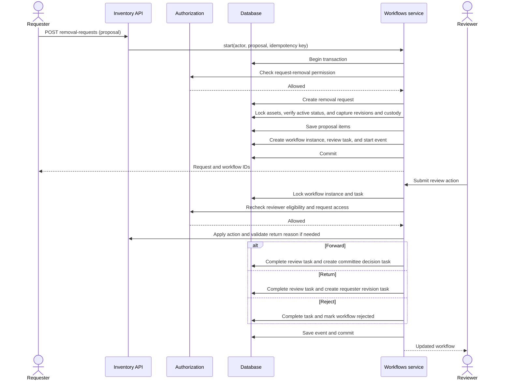
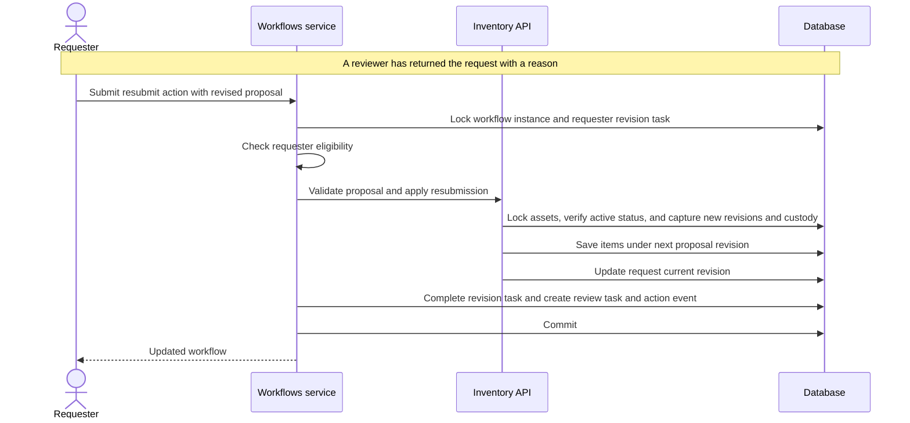
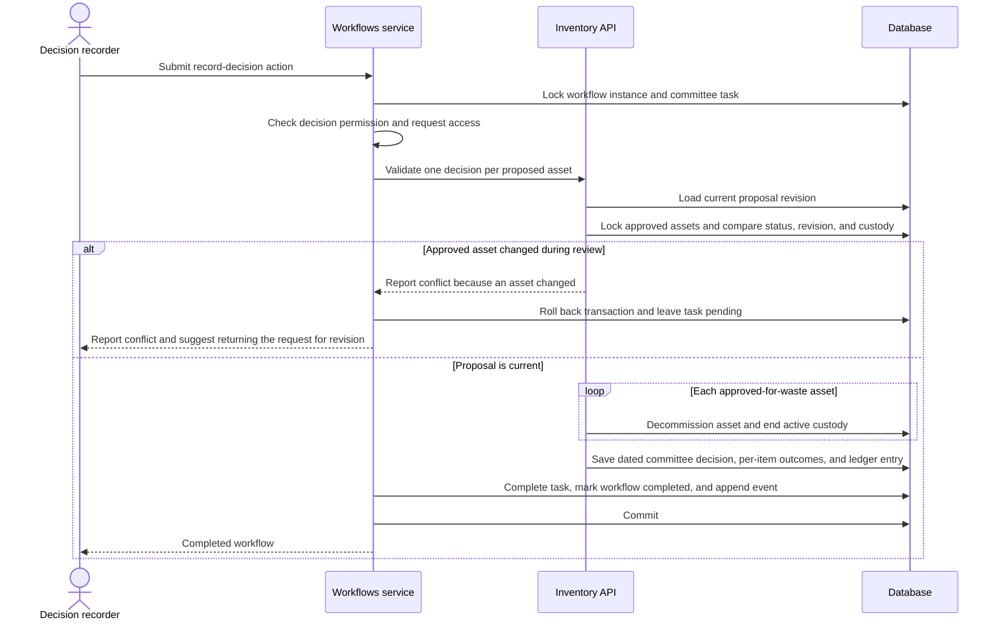

# Inventory removal workflow

This document describes the asset removal workflow implemented by the Inventory module. It covers proposal submission, review and revision, and recording the committee decision.

## Inbox and pages

Start from **Propose asset removal** in Inventory. The shared inbox at
`/workflow/tasks` links to an Inventory removal task through the shared task
route, which forwards the task to `/inventory/workflow/tasks/:taskId`.

| Task step          | Who sees it in their inbox                     | Actions on the Inventory page                         |
| ------------------ | ---------------------------------------------- | ----------------------------------------------------- |
| Review             | Eligible users with `inventory:removal-review` | Forward to committee, return with a reason, or reject |
| Revise             | Original requester                             | Edit and resubmit the proposal                        |
| Committee decision | Eligible users with `inventory:removal-decide` | Record each item's outcome or return with a reason    |

A successful action opens `/inventory/workflow/instances/:instanceId` for the
person who submitted it. Any next task appears in the next eligible user's
inbox. The same task page loads the task by ID and displays the actions returned
by the API. [Inventory routes](../inventory/IMPLEMENTATION-SPEC.md#removal-pages-and-task-routing)

## Submit and review

The requester submits proposed assets and reasons. The API checks the request-removal permission, saves the proposal and starts a workflow in one transaction. A reviewer can forward the proposal to the committee, return it for revision with a reason, or reject it.

## Return and resubmit

When a reviewer or committee decision recorder returns the request, the requester can submit a revised proposal. Inventory saves the new items as a new revision and routes the workflow back to review.

## Record committee decision

An authorized recorder submits exactly one outcome for every asset in the current proposal revision. Approved-for-waste assets are checked against the status, revision, and custody captured in the proposal. A stale asset causes the transaction to roll back, leaving the workflow task pending so the request can be returned for revision.

Record physical disposal as a separate Inventory transaction after committee approval.
